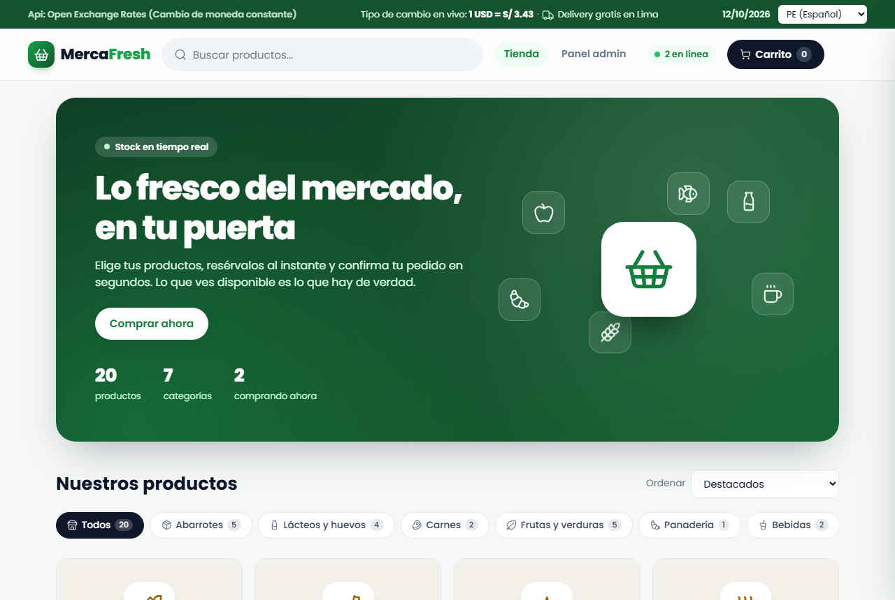
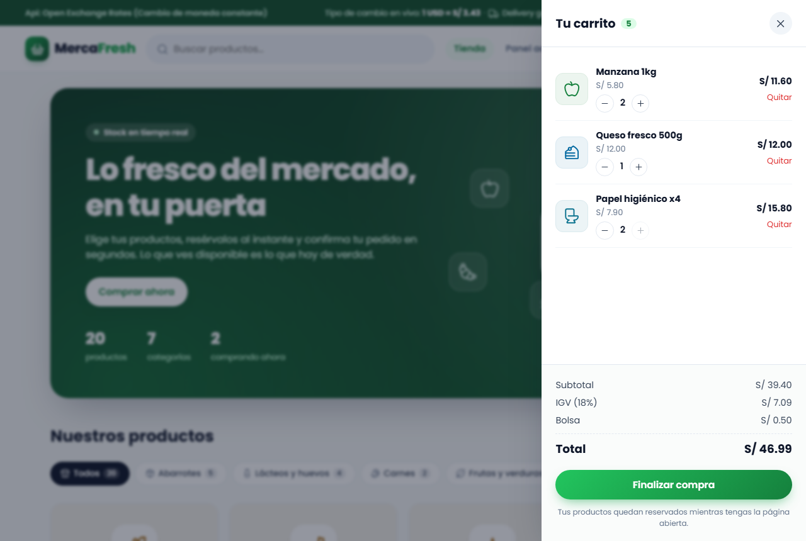
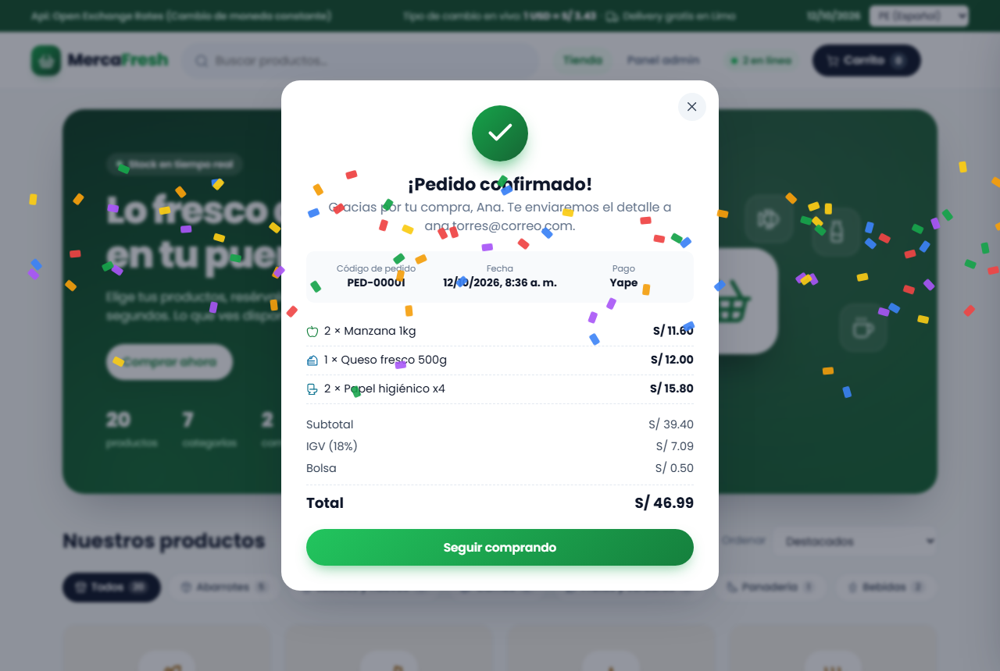
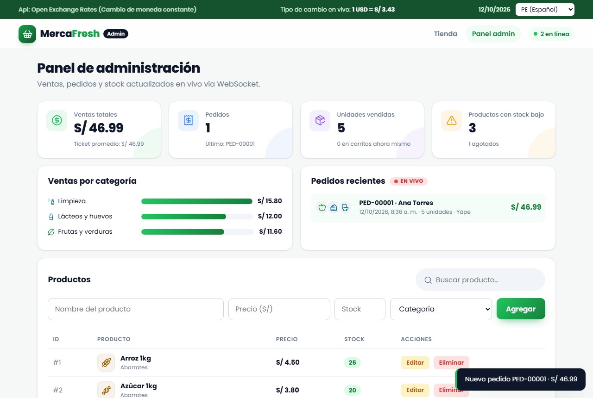

# MercaFresh · Supermercado en línea

Tienda de supermercado hecha en Python con **FastAPI**, con arquitectura en **N capas**. Los clientes compran con stock en tiempo real y el administrador ve las ventas en vivo desde un panel.

**Autor:** Piero Delgado

**Informe de avance con capturas:** [docs/INFORME.md](docs/INFORME.md)



---

## Tecnologías pedidas y dónde están

| Requisito | Dónde se ve | Archivos |
|---|---|---|
| **Arquitectura en N capas** | Presentación → Negocio → Datos, con inyección de dependencias (DIP) | `app/controllers/`, `app/services/`, `app/repositories/`, `app/models/` |
| **Funciones stateful y stateless** | Carrito, catálogo y dashboard | `static/cart.js`, `static/catalog.js`, `static/dashboard.js` |
| **Internacionalización** | Menú **PE (Español) / EEUU (English)**: idioma, moneda (S/ ↔ $) y formato de fecha | `static/i18n.js` |
| **Validación front-end y back-end** | Formulario de productos y checkout, con regex en el navegador y en el servidor | `static/validation.js`, `app/services/product_service.py`, `app/services/order_service.py` |
| **WebSockets** | Stock reservado en vivo, usuarios en línea, pedidos que llegan al panel y notificaciones | `app/controllers/realtime_controller.py`, `static/realtime.js` |

---

## Páginas

| Ruta | Página | Qué hace |
|---|---|---|
| `/` | **Tienda** | Banner, buscador, filtros por categoría, orden, catálogo con stock en vivo, carrito lateral y checkout con comprobante. |
| `/admin` | **Panel admin** | KPIs (ventas, pedidos, unidades, stock bajo), ventas por categoría, pedidos recientes en vivo y gestión de productos. |
| `/carrito` | — | Redirige a `/`. El carrito ahora es un panel lateral dentro de la tienda. |

### Flujo de compra

1. El cliente pulsa **Agregar**. El servidor reserva la unidad por WebSocket y el ícono del producto "vuela" al botón del carrito.
2. En el **carrito lateral** puede subir o bajar cantidades. Cada cambio reserva o libera stock para los demás clientes.
3. **Finalizar compra** abre el **checkout**: nombre y apellido, DNI, celular, correo, dirección y método de pago (tarjeta, Yape o efectivo).
4. Se validan los datos en el navegador. `POST /api/pedidos` los **vuelve a validar en el servidor**, calcula los totales con los precios del servidor, descuenta el stock y guarda el pedido en `data/orders.json`.
5. Aparece el **comprobante** con código `PED-00001`, el detalle y el total, junto con una animación de confeti. Al mismo tiempo, el pedido aparece en el panel admin.




### Panel de administración



- **KPIs con animación de conteo:** ventas totales y ticket promedio, pedidos, unidades vendidas, unidades en carritos ahora mismo y productos con stock bajo o agotados.
- **Ventas por categoría:** barras que crecen al cargar.
- **Pedidos recientes "EN VIVO":** cada pedido nuevo entra por WebSocket con un resaltado y una notificación.
- **Productos:** alta, edición y baja con nombre, precio, stock y categoría, buscador y stock por colores (verde, ámbar y rojo), además de las unidades que están "en carritos".

---

## Arquitectura en N capas

```
app/
├── controllers/          ← Capa de Presentación (rutas REST y WebSocket)
│   ├── product_controller.py     /api/productos
│   ├── order_controller.py       /api/pedidos
│   ├── exchange_controller.py    /api/tipo-cambio
│   └── realtime_controller.py    /ws
├── services/             ← Capa de Lógica de Negocio (reglas y validaciones)
│   ├── product_service.py        valida nombre, precio, stock y categoría
│   ├── order_service.py          valida al cliente, calcula IGV y total, crea el pedido
│   ├── stock_reservation_service.py   reservas: disponible = stock − reservado
│   ├── realtime_service.py       arma y difunde los mensajes WebSocket
│   ├── connection_manager.py     registro de conexiones abiertas
│   └── exchange_rate_service.py  consume la API externa de tipo de cambio
├── repositories/         ← Capa de Acceso a Datos (interfaces + JSON en disco)
│   ├── base.py / json_product_repository.py   data/products.json
│   └── order_repository.py                    data/orders.json
├── models/               ← Modelos Pydantic (Product*, Order*, CustomerData)
└── container.py          ← Instancias compartidas (contenedor IoC sencillo)
```

- Cada servicio recibe la **interfaz** de su repositorio (`ProductRepositoryInterface`, `OrderRepositoryInterface`), no una clase concreta (principio DIP).
- La API REST y el WebSocket comparten las mismas instancias (`app/container.py`), así los dos ven el mismo stock.
- **El backend nunca confía en los montos del navegador.** El pedido se arma con los precios guardados en el servidor y las cantidades que la sesión tiene reservadas.

---

## Funciones stateful y stateless

### En el carrito (`static/cart.js`), las 4 originales de la tarea

| Tipo | Función | Qué hace |
|---|---|---|
| Stateful | `agregarAlCarrito(producto)` | Si ya está, suma 1; si no, lo agrega con cantidad 1. Modifica el arreglo global `carrito`. |
| Stateful | `quitarDelCarrito(productoId)` | Resta 1 y lo elimina al llegar a 0. Modifica `carrito`. |
| Stateless | `calcularSubtotal(items)` | Retorna la suma de `precio * cantidad`. |
| Stateless | `calcularTotalCarrito(items, tasaIgv, costoBolsa)` | Retorna `{ subtotal, igv, bolsa, total }`. |

### Otras funciones que siguen el mismo patrón

- **Stateful (`cart.js`):** `eliminarDelCarrito`, `vaciarCarrito`, `ajustarCarrito`.
- **Stateless:**
  - `contarUnidades` y `cantidadEnCarrito` en `cart.js`
  - `filtrarProductos`, `ordenarProductos` y `normalizarTexto` en `catalog.js`
  - `calcularEstadisticas`, `ventasPorCategoria` y `resumenStock` en `dashboard.js`

### Reglas de negocio

- **IGV:** 18% sobre el subtotal.
- **Bolsa:** S/ 0.50, solo si hay al menos un producto.
- Son las mismas en el navegador (`cart.js`) y en el servidor (`order_service.py`).

---

## Internacionalización (i18n)

Arriba a la derecha de todas las páginas hay un menú con **PE (Español)** y **EEUU (English)**, con la fecha de hoy al costado. La elección se recuerda entre páginas.

| | PE (Español) | EEUU (English) |
|---|---|---|
| Idioma | Español | Inglés |
| Moneda | Soles: `S/ 4.50` | Dólares: `$1.31` |
| Fecha | `12/10/2026` (día/mes/año) | `10/12/2026` (mes/día/año) |

- **Qué se traduce:** todos los textos, incluidas las categorías, los mensajes de validación, las notificaciones, el comprobante y los errores del backend.
- **Nombres de productos:** los 20 productos por defecto tienen nombre en inglés. Los que crea el usuario se muestran igual en los dos idiomas.
- **Precios:** se guardan **siempre en soles**. En EEUU se convierten al mostrarlos, con el tipo de cambio en vivo.
- **Archivos siempre actualizados:** las páginas se sirven con la versión de sus CSS/JS en la URL (`styles.css?v=...`) y con `Cache-Control: no-cache`, para que el navegador nunca use archivos viejos.

---

## Tipo de cambio en tiempo real (API externa)

La barra superior muestra **"Api: Open Exchange Rates (Cambio de moneda constante)"** y la tasa del día, por ejemplo **"1 USD = S/ 3.43"**.

- **Backend** (`app/services/exchange_rate_service.py`): consulta [Open Exchange Rates](https://www.exchangerate-api.com/) (`open.er-api.com`, gratuita y sin API key). Si la API falla, usa `3.75` como respaldo, sin romper la aplicación.
- **Endpoint propio:** `GET /api/tipo-cambio`, por ejemplo:
  ```json
  { "moneda_origen": "USD", "moneda_destino": "PEN", "tasa": 3.397195, "fecha": "Fri, 25 Sep 2026 00:02:31 +0000", "fuente": "open-er-api" }
  ```
- **Frontend** (`static/i18n.js`): reemplaza el valor de respaldo por la tasa real y dispara `exchangerateupdate`, que vuelve a pintar los precios sin recargar la página.
- **Nota:** primero se evaluó [Frankfurter](https://frankfurter.dev), pero no incluye el sol peruano (PEN).

---

## Validación front-end y back-end (regex)

Cada formulario se valida en el navegador antes de enviarse: al salir de cada campo y de nuevo al enviar. Los errores aparecen bajo el campo, en el idioma activo. El **servidor aplica las mismas reglas** y responde `400` si algo no cumple, aunque alguien salte el navegador (por ejemplo, desde Swagger).

### Productos (panel admin): `validation.js` ↔ `product_service.py`

| Campo | Regex | Qué acepta |
|---|---|---|
| Nombre | `^(?=.*\p{L})[\p{L}\p{N}][\p{L}\p{N} .,'%()/+-]{1,59}$` | 2 a 60 caracteres: letras (con tildes y ñ), números, espacios y `. , ' % ( ) / + -`; al menos una letra. |
| Precio | `^(?!0+(?:[.,]0+)?$)(?:0\|[1-9]\d{0,5})(?:[.,]\d{1,2})?$` | Mayor a 0, hasta 6 enteros y 2 decimales, con punto o coma. |
| Stock | `^(?:0\|[1-9]\d{0,4})$` | Entero de 0 a 99999. |
| Categoría | Una de las 7 claves (`abarrotes`, `lacteos`, `carnes`, `frutas_verduras`, `panaderia`, `bebidas`, `limpieza`) | El backend rechaza cualquier otra. |

### Checkout (tienda): `validation.js` ↔ `order_service.py`

| Campo | Regex | Qué acepta |
|---|---|---|
| Nombre y apellido | `^(?=.{3,60}$)\p{L}+(?:[ '-]\p{L}+)+$` | Al menos dos palabras de solo letras, de 3 a 60 caracteres. |
| DNI | `^\d{8}$` | Exactamente 8 dígitos. |
| Celular | `^9\d{8}$` | 9 dígitos que empiezan en 9 (celular peruano). |
| Correo | `^[A-Za-z0-9._%+-]+@[A-Za-z0-9-]+(?:\.[A-Za-z0-9-]+)*\.[A-Za-z]{2,}$` | `usuario@dominio.ext` |
| Dirección | `^(?=.*\p{L})[\p{L}\p{N} .,#°º/-]{5,100}$` | 5 a 100 caracteres, con al menos una letra. |
| Método de pago | `efectivo`, `tarjeta` o `yape` | — |

En Python, `\p{L}` (cualquier letra) se escribe `[^\W\d_]`, porque el módulo `re` no soporta `\p{…}`.

---

## Tiempo real con WebSockets

Las dos páginas mantienen abierta una conexión **WebSocket** (`ws://127.0.0.1:8000/ws`). A diferencia de HTTP, donde el navegador siempre pregunta primero, aquí **el servidor avisa** a todas las pestañas apenas algo cambia.

### Qué se actualiza en vivo

1. **Stock con reservas:**
   - Al pulsar **Agregar** se reserva una unidad y los demás ven bajar **"Disponibles: N"** y la barra de stock al instante.
   - Con pocas unidades aparece **"¡Últimas N!"**. Al llegar a 0 aparece **Agotado** y el botón se desactiva para todos.
   - **Quitar** o **cerrar la pestaña** libera las unidades. **Confirmar el pedido** las descuenta definitivamente.
   - Si se corta la conexión, el navegador se reconecta solo y vuelve a reservar su carrito.
2. **Pedidos en vivo:** cada compra aparece al instante en el panel admin (KPIs, barras y feed). Las demás tiendas abiertas reciben el aviso "Otro cliente acaba de comprar…".
3. **Catálogo sincronizado:** crear, editar o eliminar un producto en el panel actualiza todas las tiendas abiertas. Si el producto eliminado estaba en un carrito, se quita de ese carrito con un aviso.
4. **Usuarios en línea:** el indicador "● N en línea" del encabezado y el contador "comprando ahora" del banner.

### Cómo está construido

| Archivo | Capa | Responsabilidad |
|---|---|---|
| `app/controllers/realtime_controller.py` | Presentación | `@router.websocket("/ws")`: recibe las acciones del cliente y responde. |
| `app/services/stock_reservation_service.py` | Negocio | Reservas por cliente, liberación y confirmación. Usa un `Lock` porque la API REST corre en hilos aparte. |
| `app/services/realtime_service.py` | Negocio | Arma los mensajes (`usuarios`, `stock`, `producto`, `pedido`) y los difunde. |
| `app/services/connection_manager.py` | Negocio | Enviar a un cliente o difundir (*broadcast*) a todos. |
| `app/controllers/product_controller.py`, `order_controller.py` | Presentación | Tras cada cambio avisan por WebSocket con `BackgroundTasks`, después de responder. |
| `static/realtime.js` | Frontend | Conexión con reconexión automática. Reenvía cada mensaje como evento `rt:<tipo>` y muestra el indicador y las notificaciones. |

`agregarAlCarrito` se llama recién cuando el servidor **confirma la reserva**, así dos clientes nunca se llevan la misma última unidad.

### Mensajes del protocolo

| Dirección | Mensaje |
|---|---|
| Cliente → servidor | `{"accion": "reservar", "producto_id": 1}`, `{"accion": "liberar", "producto_id": 1, "cantidad": 1}`, `{"accion": "sincronizar", "items": [...]}` |
| Servidor → cliente | `{"tipo": "sesion", "cliente_id": "..."}`, `{"tipo": "usuarios", "conectados": 3}`, `{"tipo": "stock", "productos": {"1": {"stock": 25, "reservado": 2, "disponible": 23}}}`, `{"tipo": "reserva", "producto_id": 1, "ok": false}`, `{"tipo": "producto", "evento": "creado", "producto": {...}}`, `{"tipo": "pedido", "pedido": {...}}` |

Para comprar, el navegador envía su `cliente_id` de sesión en `POST /api/pedidos`. Así el servidor sabe qué reservas convertir en pedido.

---

## Animaciones y diseño

- **Íconos:** set de línea [Lucide](https://lucide.dev) (licencia ISC), incrustado en `static/icons.js` para que funcione sin internet. Cada categoría tiene un color de acento sobrio.
- **Banner:** tarjetas translúcidas con íconos que flotan suavemente y entrada suave.
- **Catálogo:**
  - tarjetas que aparecen en cascada y se elevan al pasar el mouse
  - carga con *skeleton*
  - barra de stock animada
  - insignia "¡Últimas N!" que late
- **Al agregar:** el producto **vuela al carrito** y el botón del carrito rebota.
- **Carrito y checkout:**
  - carrito lateral deslizable
  - modal con entrada elástica
  - campos con error que tiemblan
- **Al comprar:** confeti y check animado en el comprobante.
- **Panel:** KPIs con conteo animado y destello al cambiar, barras que crecen y pedidos nuevos resaltados.
- **Accesibilidad:** con `prefers-reduced-motion` del sistema activado, las animaciones se desactivan.
- **Responsive:** el diseño se adapta a celular.

---

## Persistencia de datos

| Archivo | Contenido |
|---|---|
| `data/products.json` | Productos con nombre, precio, stock y categoría. |
| `data/orders.json` | Pedidos. Se crea vacío la primera vez que arranca el servidor. |

Las reservas de los carritos viven en memoria y se liberan al cerrar la pestaña.

---

## Cómo ejecutar el proyecto

```
python -m venv .venv
source .venv/Scripts/activate
pip install -r requirements.txt
python main.py
```

- **Tienda:** `http://127.0.0.1:8000/`
- **Panel admin:** `http://127.0.0.1:8000/admin`
- **Documentación interactiva (Swagger):** `http://127.0.0.1:8000/docs`
- **API REST:** `/api/productos`, `/api/pedidos`, `/api/tipo-cambio`
- **WebSocket:** `ws://127.0.0.1:8000/ws`

### Demo sugerida para la presentación

1. Abre la **tienda** y el **panel admin** lado a lado (**Win + ←** y **Win + →**).
2. En la tienda, agrega productos. En el panel sube "en carritos" y cambia la columna Stock.
3. Agrega todas las unidades de **Papel higiénico x4**. En la otra ventana aparece **Agotado**.
4. Pulsa **Finalizar compra**. Prueba primero un DNI de 4 dígitos para mostrar la validación, luego completa bien y confirma. Sale el confeti y el pedido entra al panel con su notificación.
5. Cambia a **EEUU (English)** para mostrar idioma, dólares y formato de fecha.
6. Desde el panel, edita el precio de un producto y míralo cambiar en la tienda sin recargar.
