# Informe de avance · Proyecto final

## MercaFresh: supermercado en línea con arquitectura en N capas

**Autor:** Piero Delgado
**Fecha:** 12/10/2026
**Tecnologías:** Python 3.13 · FastAPI · JavaScript · HTML/CSS

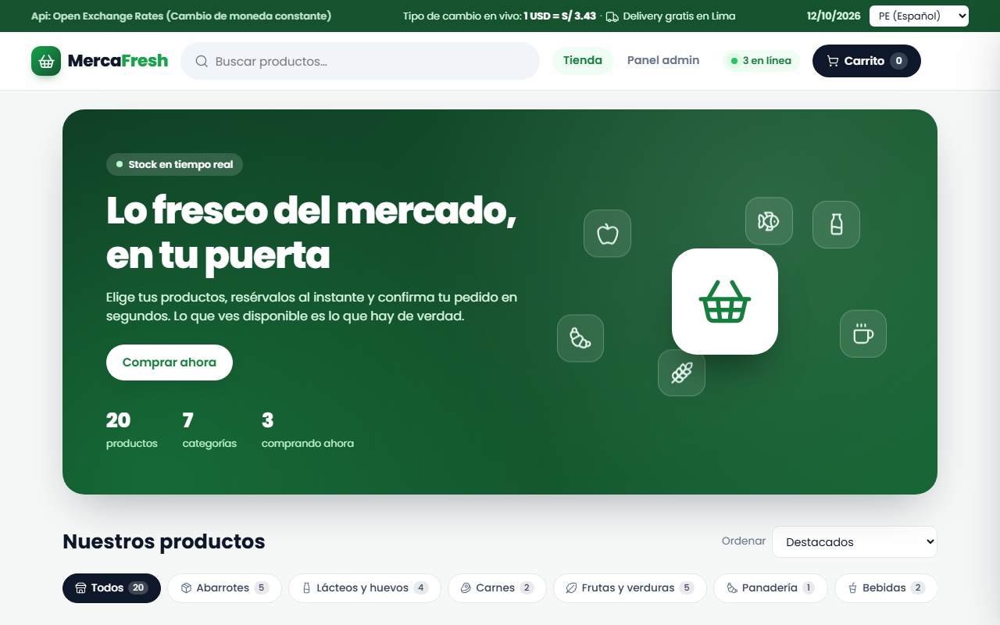

---

## 1. Resumen

MercaFresh es una tienda de supermercado en línea con dos vistas:

- **La tienda (`/`):** el cliente busca productos, los agrega al carrito y confirma su pedido.
- **El panel de administración (`/admin`):** el encargado ve las ventas y gestiona el catálogo.

Este avance presenta las cuatro tecnologías pedidas funcionando sobre una arquitectura en N capas:

| Requisito | Estado | Sección |
|---|---|---|
| Arquitectura en N capas | ✅ Implementado | [2](#2-arquitectura-en-n-capas) |
| Funciones stateful y stateless | ✅ Implementado | [3](#3-funciones-stateful-y-stateless) |
| Internacionalización | ✅ Implementado | [4](#4-internacionalización-i18n) |
| Validación front-end y back-end | ✅ Implementado | [5](#5-validación-front-end-y-back-end) |
| Web Sockets | ✅ Implementado | [6](#6-web-sockets-tiempo-real) |

---

## 2. Arquitectura en N capas

El backend separa las responsabilidades en tres capas, más los modelos de datos. Cada capa solo conoce a la de abajo.

```
 Navegador (tienda / panel)
        │  HTTP (REST)  y  WebSocket
        ▼
 ┌──────────────────────────────┐
 │ Presentación   controllers/  │  Rutas: /api/productos, /api/pedidos, /api/tipo-cambio, /ws
 ├──────────────────────────────┤
 │ Negocio        services/     │  Reglas: validaciones, IGV, reservas de stock, pedidos
 ├──────────────────────────────┤
 │ Datos          repositories/ │  Lectura y escritura de data/products.json y data/orders.json
 └──────────────────────────────┘
        models/  → estructuras de datos (Pydantic)
```

- **Inversión de dependencias (DIP):** cada servicio recibe una **interfaz** de repositorio (`ProductRepositoryInterface`, `OrderRepositoryInterface`), no una clase concreta. Para cambiar el JSON por una base de datos real solo habría que escribir otro repositorio.
- **Una sola fuente de datos:** la API REST y el canal en tiempo real usan las mismas instancias (`app/container.py`), así los dos siempre ven el mismo stock.
- **El servidor no confía en el navegador:** al crear un pedido, los precios y totales se calculan en la capa de negocio con los datos del servidor.

La documentación automática de FastAPI (`/docs`) muestra la capa de presentación, es decir, todos los endpoints REST:

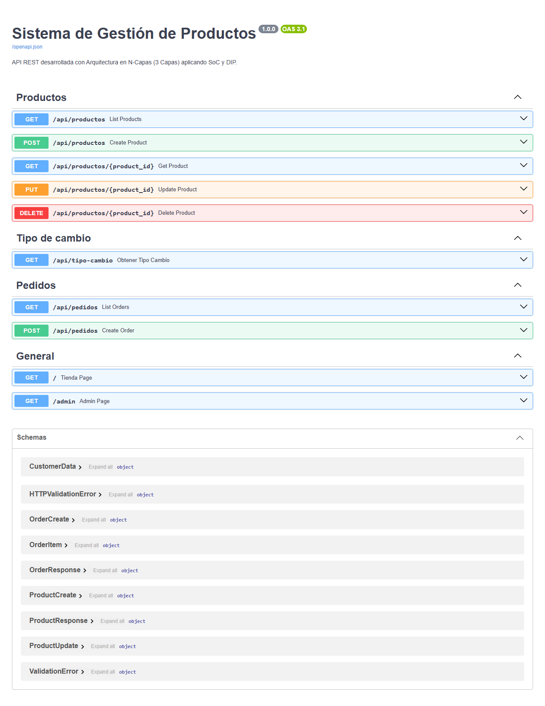

---

## 3. Funciones stateful y stateless

- **Stateful:** lee y **modifica un estado compartido**, en este caso el arreglo global `carrito`.
- **Stateless (pura):** **solo depende de sus parámetros** y siempre devuelve el mismo resultado, sin efectos secundarios.

| Tipo | Función | Archivo | Qué hace |
|---|---|---|---|
| Stateful | `agregarAlCarrito(producto)` | `static/cart.js` | Suma 1 unidad o agrega el producto al `carrito` |
| Stateful | `quitarDelCarrito(productoId)` | `static/cart.js` | Resta 1 unidad y lo elimina al llegar a 0 |
| Stateless | `calcularSubtotal(items)` | `static/cart.js` | Retorna la suma de `precio × cantidad` |
| Stateless | `calcularTotalCarrito(items, igv, bolsa)` | `static/cart.js` | Retorna `{ subtotal, igv, bolsa, total }` |
| Stateless | `filtrarProductos(productos, filtro)` | `static/catalog.js` | Búsqueda sin tildes y filtro por categoría |
| Stateless | `ordenarProductos(productos, orden)` | `static/catalog.js` | Retorna una **copia** ordenada, sin modificar la original |

```js
// Stateful: modifica el estado global `carrito`
function agregarAlCarrito(producto) {
  const existente = carrito.find((item) => item.id === producto.id);
  if (existente) existente.cantidad += 1;
  else carrito.push({ ...producto, cantidad: 1 });
  notificarCambio();
}

// Stateless: mismo resultado para los mismos parámetros
function calcularTotalCarrito(items, tasaIgv = 0.18, costoBolsa = 0.5) {
  const subtotal = calcularSubtotal(items);
  const igv = Math.round(subtotal * tasaIgv * 100) / 100;
  const bolsa = items.length > 0 ? costoBolsa : 0;
  return { subtotal, igv, bolsa, total: subtotal + igv + bolsa };
}
```

**En la aplicación**, el carrito es el estado que modifican las funciones *stateful*, y los totales (subtotal, IGV 18%, bolsa) los calculan las funciones *stateless*:

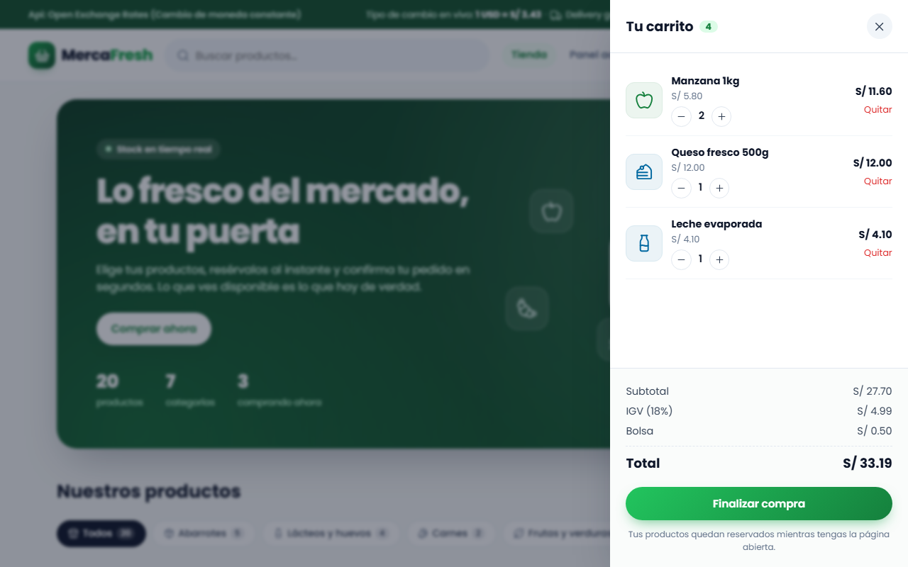

La búsqueda, el filtro por categoría y el orden son funciones *stateless*: reciben el catálogo y devuelven un resultado nuevo sin alterarlo.

| Búsqueda "pa" | Categoría "Frutas y verduras" + orden por precio |
|---|---|
| 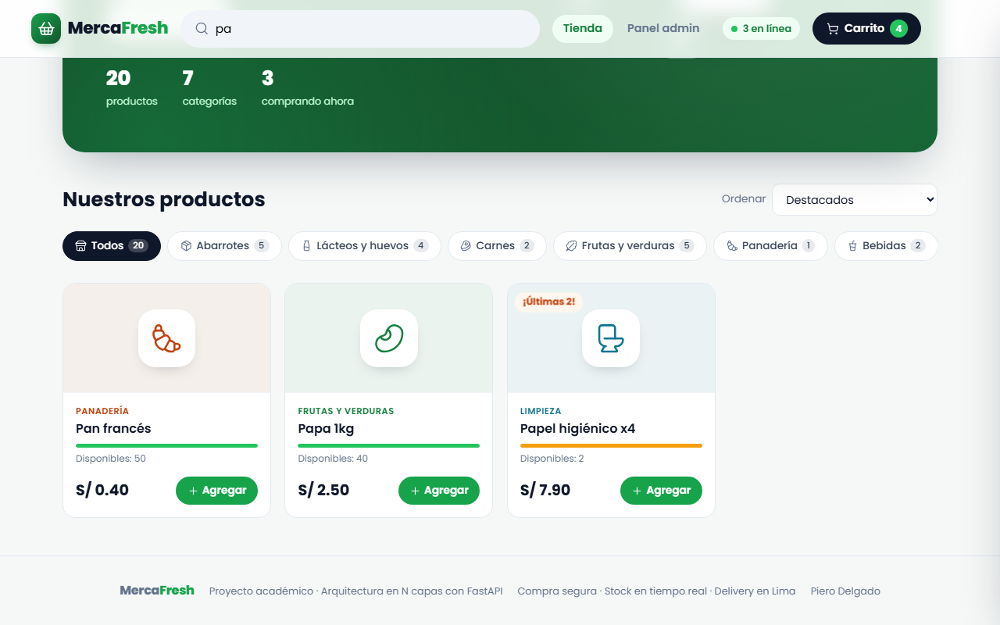 | 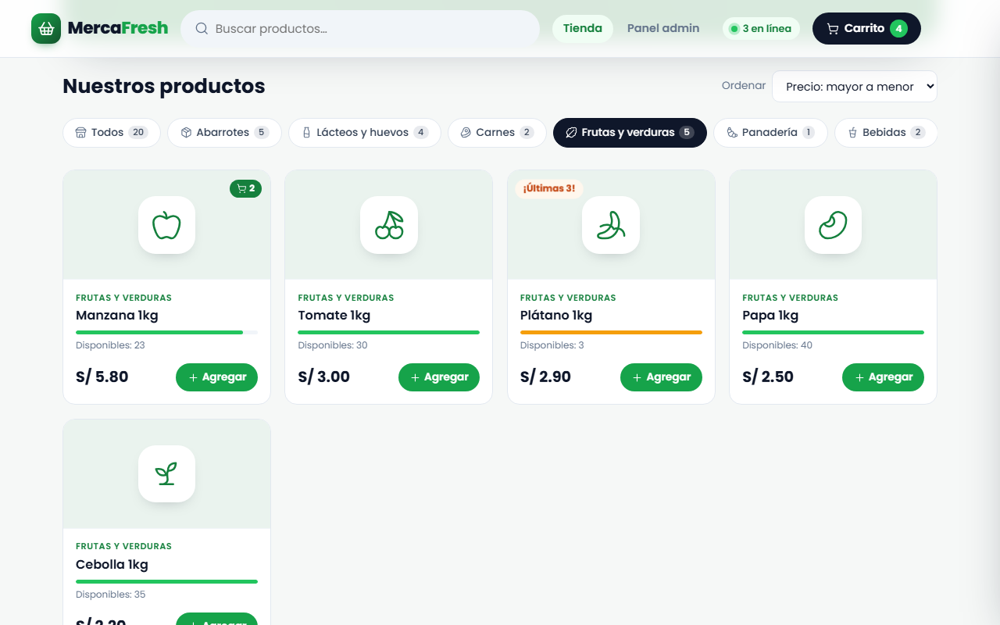 |

---

## 4. Internacionalización (i18n)

Un menú en la barra superior cambia entre **PE (Español)** y **EEUU (English)** sin recargar la página. La elección se recuerda entre páginas (`localStorage`).

| | PE (Español) | EEUU (English) |
|---|---|---|
| Textos | Español | Inglés (incluye nombres de productos y categorías) |
| Moneda | Soles: `S/ 4.90` | Dólares: `$1.43` |
| Fecha | `12/10/2026` (día/mes/año) | `10/12/2026` (mes/día/año) |
| Tipo de cambio | — | En vivo desde la API externa *Open Exchange Rates* |

Los precios se guardan **siempre en soles** y se convierten solo al mostrarlos. Para el formato de moneda y fecha se usa la API estándar `Intl` del navegador.

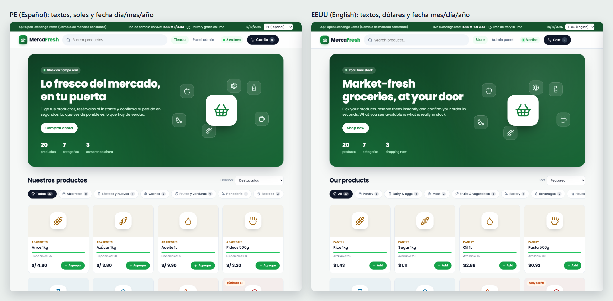

La traducción también cubre los **mensajes de validación** y el **panel de administración**:

| Validación en inglés | Panel en inglés |
|---|---|
| 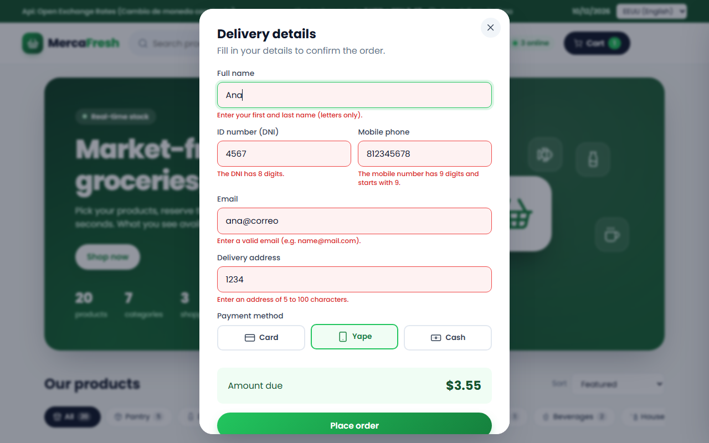 | 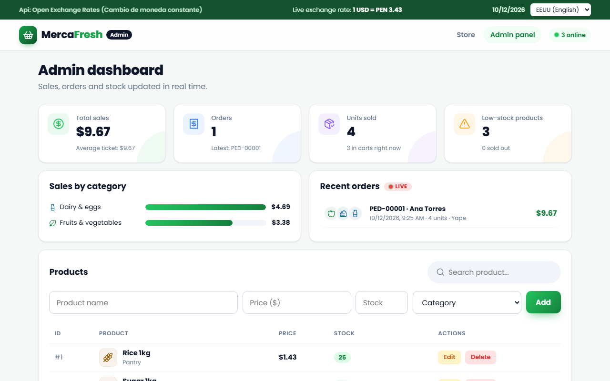 |

---

## 5. Validación front-end y back-end

Cada formulario se valida **dos veces con las mismas expresiones regulares**:

1. **Front-end** (`static/validation.js`): da respuesta inmediata al usuario, en su idioma, sin enviar nada al servidor.
2. **Back-end** (`product_service.py`, `order_service.py`): protege los datos aunque alguien salte el navegador. Responde `400 Bad Request` con el motivo.

| Campo | Regla (regex) |
|---|---|
| Nombre de producto | `^(?=.*\p{L})[\p{L}\p{N}][\p{L}\p{N} .,'%()/+-]{1,59}$` (2 a 60 caracteres, al menos una letra) |
| Precio | `^(?!0+(?:[.,]0+)?$)(?:0\|[1-9]\d{0,5})(?:[.,]\d{1,2})?$` (mayor a 0, máximo 2 decimales) |
| Stock | `^(?:0\|[1-9]\d{0,4})$` (entero de 0 a 99999) |
| Nombre del cliente | `^(?=.{3,60}$)\p{L}+(?:[ '-]\p{L}+)+$` (nombre y apellido) |
| DNI | `^\d{8}$` |
| Celular | `^9\d{8}$` |
| Correo | `^[A-Za-z0-9._%+-]+@[A-Za-z0-9-]+(?:\.[A-Za-z0-9-]+)*\.[A-Za-z]{2,}$` |

### 5.1 Front-end: errores en el navegador

En el **checkout** de la tienda (nombre sin apellido, DNI incompleto, celular que no empieza en 9, correo sin dominio, dirección muy corta):

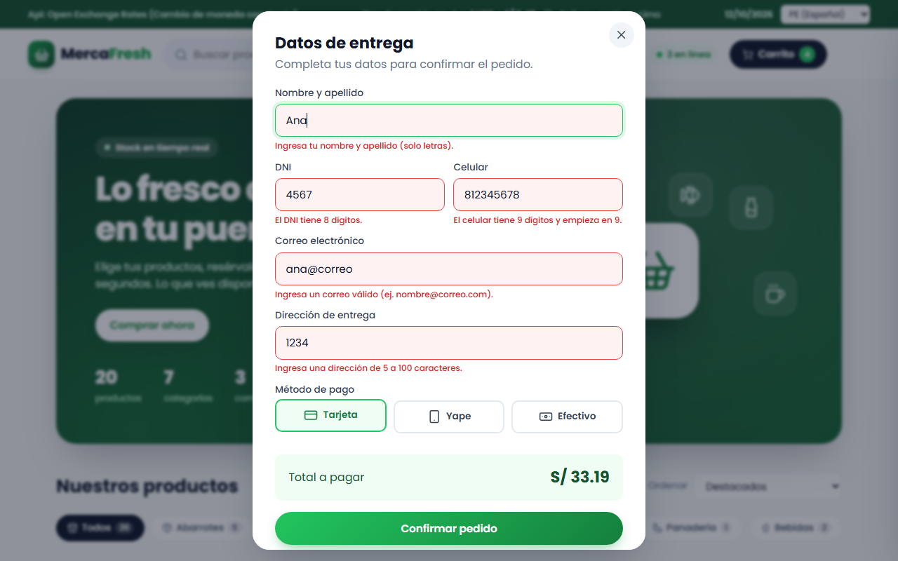

En el **formulario de productos** del panel (nombre solo con números, precio 0, stock negativo, sin categoría):

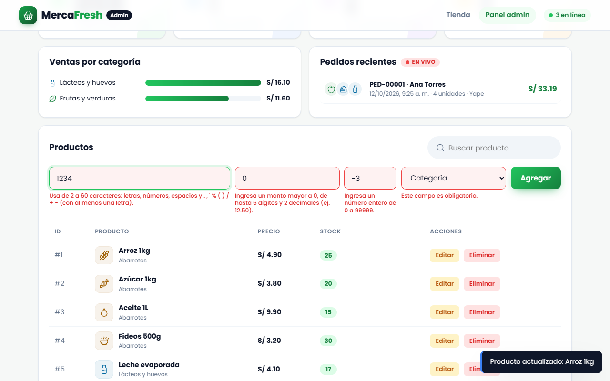

### 5.2 Back-end: el servidor rechaza datos inválidos

Estas peticiones se enviaron **directamente a la API** desde Swagger, sin pasar por el navegador. El servidor las rechaza con `400`:

| Producto con nombre inválido | Categoría inexistente | Pedido con DNI de 3 dígitos |
|---|---|---|
| 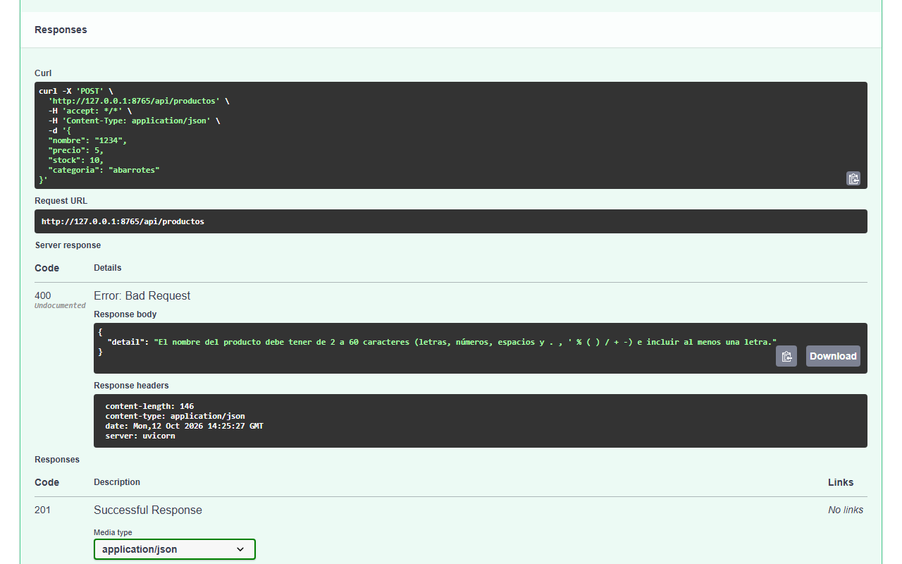 | 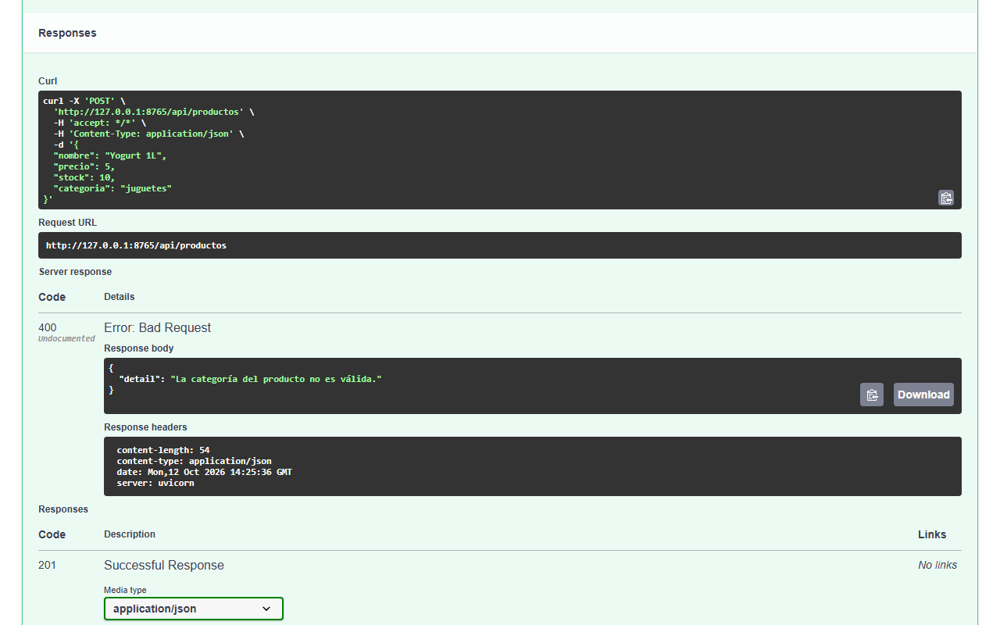 | 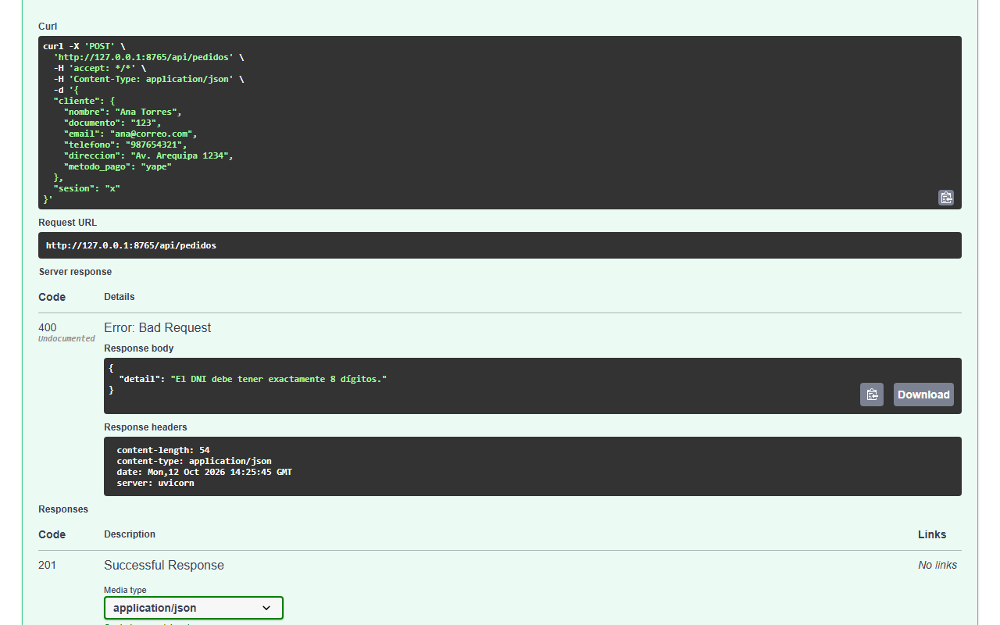 |

---

## 6. Web Sockets (tiempo real)

Con HTTP, el navegador siempre tiene que **preguntar** al servidor. Con un **WebSocket**, la conexión queda abierta y **el servidor avisa** a todas las pestañas apenas algo cambia. Así funciona el tiempo real de MercaFresh:

| Archivo | Capa | Responsabilidad |
|---|---|---|
| `app/controllers/realtime_controller.py` | Presentación | Endpoint `/ws`: recibe acciones y responde |
| `app/services/stock_reservation_service.py` | Negocio | Reservas: `disponible = stock − reservado` |
| `app/services/realtime_service.py` | Negocio | Arma y difunde (*broadcast*) los mensajes |
| `static/realtime.js` | Frontend | Conexión con reconexión automática |

**Mensajes reales** capturados durante las pruebas (formato JSON):

```text
→ enviado   {"accion":"reservar","producto_id":14}
← recibido  {"tipo":"reserva","producto_id":14,"ok":true}
← recibido  {"tipo":"stock","productos":{"14":{"stock":25,"reservado":2,"disponible":23}, ...}}
← recibido  {"tipo":"usuarios","conectados":3}
← recibido  {"tipo":"producto","evento":"actualizado","producto":{"nombre":"Arroz 1kg","precio":4.9, ...}}
```

### 6.1 Usuarios en línea

El encabezado cuenta en vivo las pestañas conectadas. Sube al abrir una y baja al cerrarla.


### 6.2 Reservas de stock visibles al instante

Cuando un cliente agrega un producto, el servidor **reserva** la unidad y el panel lo muestra de inmediato:

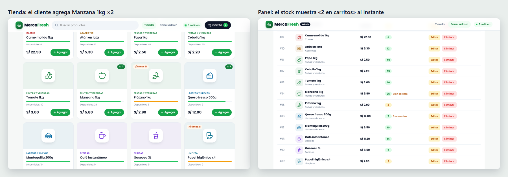

### 6.3 Un producto se agota para todos

Si un cliente reserva las últimas unidades, en la ventana del otro cliente el producto pasa a **Agotado** y el botón se desactiva, sin recargar. Así dos personas nunca compran la misma última unidad.

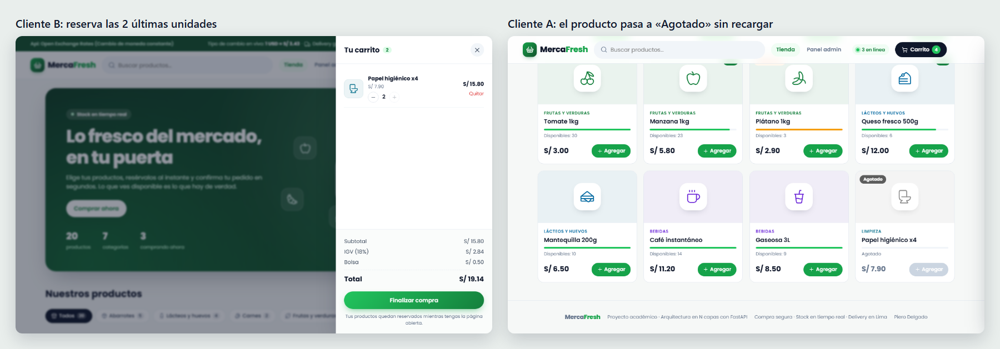

### 6.4 Un pedido llega en vivo al panel

Al confirmar la compra, el pedido aparece en el panel con sus KPIs, las ventas por categoría y una notificación:

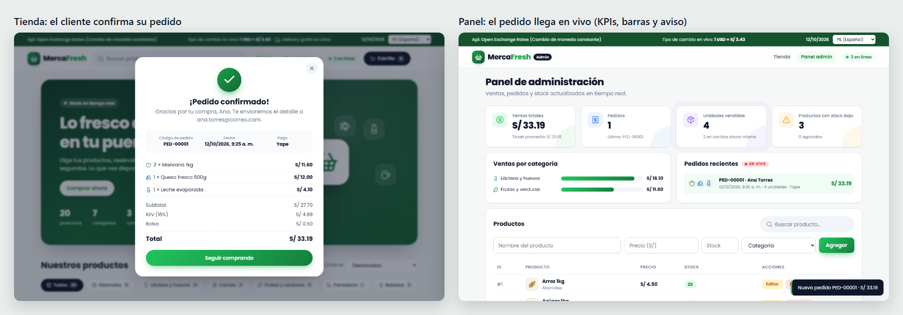

Los demás clientes conectados reciben un aviso:

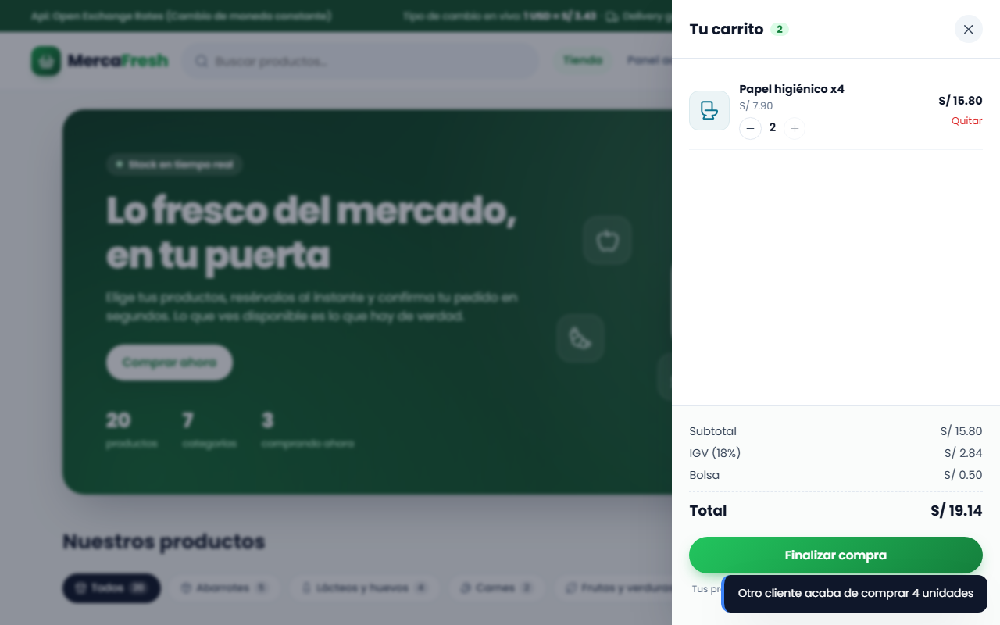

### 6.5 El panel cambia un precio y la tienda se actualiza sola

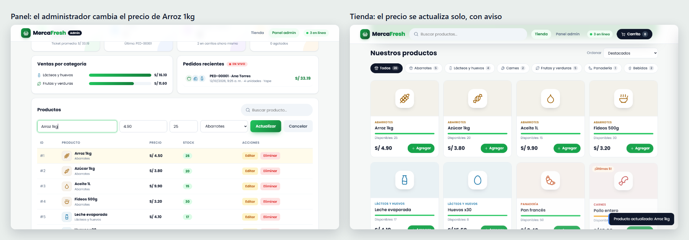

---

## 7. Conclusiones y próximos pasos

- **Lo que ya está:** las cuatro tecnologías funcionan integradas en un flujo de compra completo. Las reglas de negocio están en la capa de servicios, la validación es doble y el tiempo real mantiene coherente el stock entre varios clientes.
- **Lo que viene:** reemplazar los archivos JSON por una base de datos (gracias a DIP, sin tocar los servicios), agregar inicio de sesión para el panel y pruebas automatizadas.

---

## Cómo reproducir

```
pip install -r requirements.txt
python main.py
```

| Qué | Dónde |
|---|---|
| Tienda | `http://127.0.0.1:8000/` |
| Panel | `http://127.0.0.1:8000/admin` |
| Swagger | `http://127.0.0.1:8000/docs` |

Para ver el tiempo real, abre la tienda y el panel lado a lado (**Win + ←** y **Win + →**).
